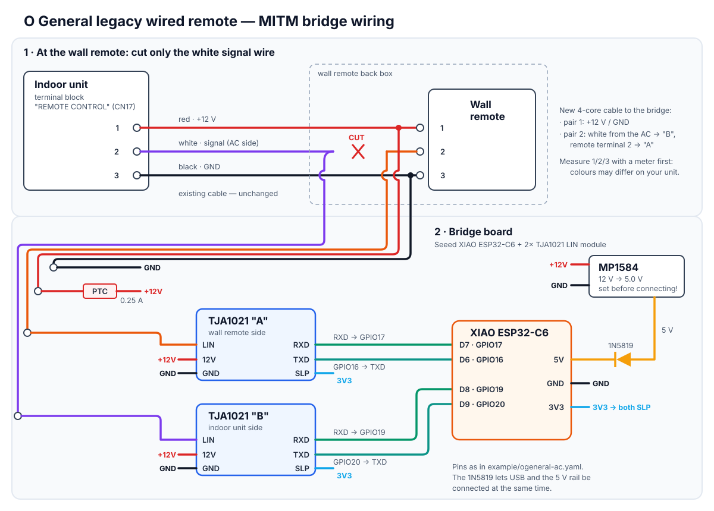

# esphome-ogeneral-legacy

ESPHome bridge that puts an **old O General / Fujitsu General air conditioner with a wired wall remote** into Home Assistant. It is meant for units too old for any official WiFi module.

It was developed on an **O General ARG25ALC** (ducted, cooling-only, R22, ~2003, made in Thailand) with its wired weekly-timer remote. The protocol it uses is **different** from the one handled by [FujiHeatPump](https://github.com/unreality/FujiHeatPump) / [esphome-fujitsu](https://github.com/FujiHeatPump/esphome-fujitsu). If those projects do not work with your old unit, this one might.

> ⚠️ **Tested on exactly one unit.** Other ARG/ARY/ART 25/30 ALC/RLC units of the same era probably use the same bus, but that is unconfirmed. Reports are welcome.

## What works

- **Read** on/off, mode, set temperature, fan speed and energy-save from the bus.
- **Control from Home Assistant:** on/off, COOL, target temperature (18–30 °C), fan AUTO/LOW/MID/HIGH.
- **The wall remote keeps working.** A key press on it always wins over HA.
- **No `EE` errors on the remote:** the bridge keeps both ends of the bus consistent.

## Limitations

- **The remote's LCD does not update** when you change something from HA. It keeps showing its own last state, while the AC does what HA asked.
- **Only the modes this unit has** are exposed: COOL and OFF. FAN-only and energy-save are decoded but not exposed in the climate entity. Heat-pump models were not tested.
- **The bridge sits in series with the remote's signal wire.** If the ESP is unpowered, the remote cannot talk to the AC.

## How it works (short)

The wall remote is the bus master. It polls the indoor unit every ~240 ms and re-asserts its own on/off state in every poll. A second transmitter on the same wire is therefore ignored.

The bridge instead cuts the signal wire at the remote and sits in the middle with two LIN transceivers:
- an ISR forwards every bit both ways, adding only microseconds;
- when HA wants a change, the bridge replaces one of the remote's polls with the remote's own command frame carrying the new state.

Full protocol: **[docs/protocol.md](docs/protocol.md)**.

## Hardware

| Part | Notes |
|---|---|
| Seeed **XIAO ESP32-C6** | other ESP32s should work with pin changes; the bridge code uses ESP-IDF GPIO LL + UART0/UART1 matrix routing |
| 2× **TJA1021 / TJA1020 LIN module** | "A" = wall remote side, "B" = indoor unit side; SLP tied to 3V3 |
| **MP1584** (or LM2596) buck, 12 V → 5.0 V | set to 5.0 V **before** connecting the ESP |
| 1N5819 Schottky diode | buck output → XIAO 5V, so USB can be plugged in at the same time |
| PTC fuse ~0.25 A | in the +12 V line taken from the bus |
| 4-core cable | +12 V / GND pair + the two halves of the cut signal wire |



Bus terminals on the ARG25ALC: **1 red +12 V, 2 white signal, 3 black GND**. Check yours with a multimeter first.

## Installation

1. Copy [`example/ogeneral-ac.yaml`](example/ogeneral-ac.yaml) and create a `secrets.yaml` (see [`example/secrets.yaml.example`](example/secrets.yaml.example)).
2. The example pulls the components straight from this repo:
   ```yaml
   external_components:
     - source: github://aks4kj/esphome-ogeneral-legacy
       components: [ogeneral, ogeneral_bridge]
   ```
3. Flash over USB the first time, then wire it in:
   - **power the AC off at the breaker**;
   - cut the white wire at the remote;
   - connect "A" to the remote's terminal 2 and "B" to the white wire coming from the AC;
   - take +12 V and GND from terminals 1 and 3.
4. Power on. In the ESPHome logs, the `ogeneral_bridge` status line should show `fwd=1` and a growing `edges` count. The remote should work exactly as before.

Before controlling anything, run the bridge listen-only for a while and compare what the climate entity shows with the remote.

## Tips learned the hard way

- **Do not use `esp_timer` with ISR dispatch at 250 µs** on the ESP32-C6: it hangs the chip hard, and an OTA rollback does not help.
- **The bus is 12 V:** never connect it to an ESP pin directly. The LIN module also gives you open-drain TX for free.
- **When forcing a bit, force the whole bit,** starting ~400 µs before its edge: receivers sample before the bit centre.
- **To sniff your own unit,** use one LIN module plus a `uart` at 500 baud 8O1 with the debug sequence from the example. The bytes read fine, even though the 9th bit is not real parity.

## Safety

You are working inside an air conditioner that also carries mains voltage. Switch it off at the breaker before touching any wiring. This project comes with no warranty: you can damage your unit's control board, and you do this at your own risk.

## Credits

- [unreality/FujiHeatPump](https://github.com/unreality/FujiHeatPump) and the author's Hackaday.io write-up on the Fujitsu bus for the starting point and the LIN-transceiver idea.
- The service manual excerpt (ARG/ARY/ART 25/30 ALC/RLC, 2003) used for the board connector and wire colours is publicly available on [inspectapedia](https://inspectapedia.com/aircond/Fujitsu-ARG-ARY-ART-Service-Manual.pdf).

## License

MIT
